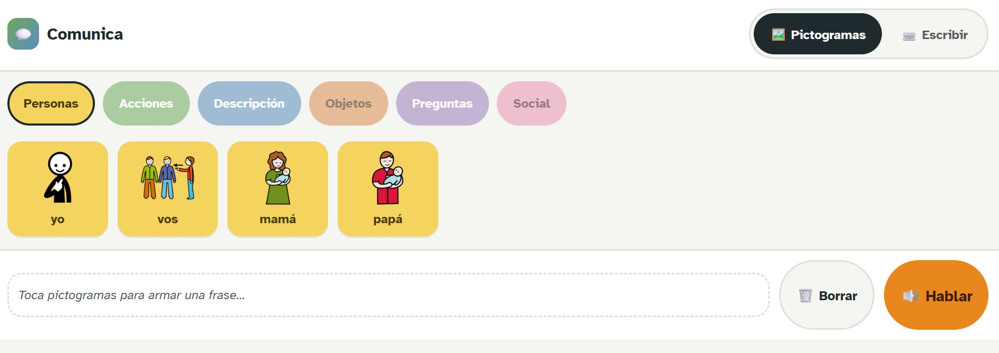
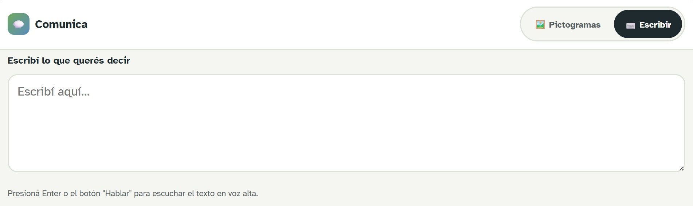

# Proyecto: aplicación de pictogramas

Este proyecto consiste en una aplicación  de tipo [PWA](https://learn.microsoft.com/es-es/microsoft-edge/progressive-web-apps/), donde 
las personas con discapacidad motora o de comunicación verbal, puedan utilizarla para comunicarse empleando pictogramas.

La idea principal de esta aplicación, es ofrecer un entorno con pictogramas tal y como se muestra en la siguiente imagen:



En la imagen se muestran la interfaz de usuario, la cuál cuenta con secciones como: **Personas**, **Acciones**, **Descripción**, etc; donde se encuentran los botones de las palabras a elegir por el usuario.

Tal como se muestra en la siguiente imágen, el usuario puede elegir cuál palabra usar tocando su ícono, ejemplo: **Yo**:


Cuando se presionan estos pictogramas, el audio procede a salir cuando se le da al botón de ***Hablar***.

También está la opción de escribir, en la cuál el usuario puede escribir las frases que desee y estas se procesan y reproducen en forma de audio.




## **Sobre el código**

# manifest.json

Este es un archivo json donde se almacenan los metadatos de la aplicación. 
A continuación se describe el propósito y función de cada una de sus líneas:

1. `` "name" `` y `` "short_name" `` es el nombre completo y el nombre corto que se va a mostrar debajo del ícono en la pantalla de inicio.
2. `` "star_url" `` caul es el archivo que abre cuando se toca el ícono.
3. `` "background_color" `` y `` "background_color" `` son los colores que usa el sistema colores que usa el sistema mienstras la app carga y en la barra de estado.
4. `` "icons" `` es la lista de íconos.


# service-worker.js


1. `` "NOMBRE_CACHE" `` es una caja donde se guardad los archivos, el v1 es porque es la versión uno, cuando se quiera cambiar se le pone v2 y se crea una nueva caja.

2. `` "ARCHIVOS_A_GUARDAR" `` es la lista de lo que neesita la aplicación para funcionar sin conexión.
3. Eventos:
   1. `` "install" `` es un evento que solo pasa una vez, la primera vez que alguien visita la app, ahí se descarga y guarda todo.
   2. `` "fetch" `` pasa siempre, cada vez que la página pide cualquier recurso. si lo tiene guardado usa ese recurso, sino lo busca en internet.


# Instalación de la aplicación:

Al tratarse de una PWA, la aplicación puede instalarse en diversos tipos de dispositivos
y sistemas operativos empleando el mismo código fuente. Esto siempre y cuando se
este utilizando un navegador web basado en Chromium como Microsoft Edge, Brave o
Google Chrome. Se puede usar Safari para iPadOS o iOS. En el caso de Mozilla Firefox, actualmente 
no provee soporte para instalación de PWAs, a pesar de que sí permite la utilización
de service workers.

Otro factor a considerar para la instalación de la aplicación, es que esta debe estar 
desplegada en un servidor web, para así poder emplear todas sus funcionalidades.
Actualmente la aplicación se encuentra desplegada en https://abrahamarce.github.io/Proyecto_aplicacion_pictogramas/.

Tras abrir la URL en un navegador, se debe presionar el botón `instalar` que aparece
en la barra de navegación. En caso de utilizar una versión móvil del navegador,
se debe presionar el menu `⋮` y seleccionar la opción de "instalar y crear
atajo".

## Despliegue de la aplicación de forma local
En caso de querer desplegar la aplicación de forma local, esto se puede lograr
empleando un servidor web http de Python. Simplemente se debe abrir una terminal 
en el directorio raíz donde esté almacenado el código fuente de la aplicación y 
ejecutar el siguiente comando:

```sh
python3 -m http.server 8000
```

Tras iniciar la ejecución del servidor, se debe acceder a la siguiente URL: http://localhost:8000.
En caso de que el puerto escogido este siendo empleado por otro proceso del sistema
operativo, este debe ser cambiado.
